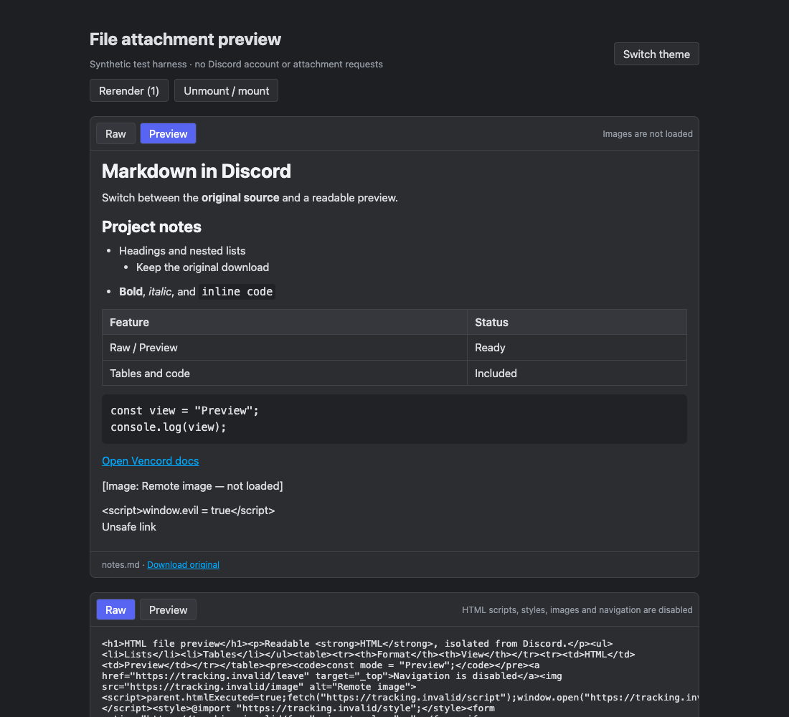

# File Preview for Vencord

A source userplugin that adds **Raw / Preview** buttons to Markdown (`.md`, `.markdown`) and HTML (`.html`, `.htm`) text attachments, including uppercase extensions. Raw is the default and preserves Discord's original source component. Preview shows headings, lists, tables and code in a readable view.



Screenshots are from an account-free **synthetic browser harness**, not the live Discord client. [Raw](docs/images/raw-dark.png) · [Light](docs/images/preview-light.png) · [HTML](docs/images/html-preview.png).

## Installation

This is a custom Vencord source plugin, not an official plugin-list entry. Follow the [custom plugin guide](https://docs.vencord.dev/installing/custom-plugins/) and [local development instructions](https://docs.vencord.dev/installing/) for a Vencord checkout. Preserve all your other userplugins when rebuilding.

1. Clone this repository alongside your Vencord checkout.
2. Copy `plugin/filePreview` into the checkout's `src/userplugins/filePreview`.
3. Add `src/userplugins/filePreview/vendor/**` to the checkout's ESLint ignores; keep all vendor licenses/provenance.
4. Run the locked dependency installation, build/type/lint checks and explicit stylesheet lint (`pnpm exec stylelint src/userplugins/filePreview/style.css`). Build using `pnpm build`, or `pnpm buildStandalone` for an existing standalone installation. Back up your installation before replacing a custom build; use the official installer as directed by Vencord's guide.
5. If you previously used **MarkdownAttachmentPreview**, disable it before enabling **FilePreview**: both patch the same native text-preview boundary. Enable FilePreview under Vencord → Plugins and restart Discord.
6. Open a supported text attachment and choose **Preview** for formatting or **Raw** for the original source.

Native download, language, word-wrap and expansion controls remain in place. Known CopyFileContents injection points are preserved. Each attachment/modal has independent state; remounting resets to Raw. Enable/disable requires a restart because the plugin uses Vencord webpack patches.

## What renders

Markdown supports headings, paragraphs, emphasis, ordered/unordered lists, blockquotes, task labels, fenced/inline code, web links and GFM tables. HTML supports basic semantic text, headings, lists, tables, quotes and code. HTML's custom CSS, source attributes, links/navigation, forms and embedded content are intentionally removed. This is a safe document preview, not a full interactive webpage preview.

HTML uses fixed dark/light styling selected by Vencord's ThemeStore. Markdown uses Discord theme variables. HTML custom-theme styling and exact original webpage appearance are unsupported. Code is displayed without syntax highlighting or execution. Mermaid is unsupported.

## Untrusted content

The plugin uses only text Discord already loaded, with no remote rendering service, account/token store, native file access or plugin network requests. Markdown HTML/scripts are literal text. Images become labels with URLs discarded. Only explicit HTTP/HTTPS Markdown links without credentials are clickable, using `noopener noreferrer` and no referrer. HTML links remain plain text.

HTML is parsed by a bundled, pure-JavaScript parse5 AST parser; no untrusted browser DOM is created during parsing. An explicit allowlist emits fixed semantic elements with escaped text and **no source attributes**. Script/style/resource/form/meta/base/SVG/MathML and other active subtrees are discarded. The result is placed in an iframe with an **empty sandbox** (no scripts, same-origin access, forms, popups, downloads or top-navigation permissions), no referrer, and a CSP that blocks scripts, connections, images, media, frames, objects, fonts, base URLs and form submissions. Only the plugin's fixed theme CSS is present. The opaque-origin sandbox prevents attachment content from accessing the parent document. See the [iframe sandbox documentation](https://developer.mozilla.org/en-US/docs/Web/HTML/Reference/Elements/iframe#sandbox) and [parse5 API](https://parse5.js.org/functions/parse5.parseFragment.html).

Both formats fail closed for missing/partial text or unknown byte counts. Limits: 64 KiB, 2,000 lines, 4,096 UTF-16 units per line, 6,000 counted tokens/nodes and nesting depth 24. Discord's verified native range loader reads approximately 50,000 bytes, so partial files can reach that limit first. Raw and original download stay available; the plugin does not fetch the remainder. Parser complexity tests are practical checks, not a formal worst-case runtime proof.

## Verification status

Integration targets Vencord `7f0c10cc29fd789f2f4828ae3dc947623e837920` and the public Discord bundle `web.91d9ed412e5a4f3b.js` captured on 2026-10-01. All three grouped patch replacements matched once in that complete public bundle during the Markdown predecessor's checks; the same signatures are replayed here against the small inline/modal compatibility fixture. Vencord applies the group together or discards it together if signatures drift.

The Markdown predecessor passed full Vencord build/type/lint checks and its installed plugin startup was observed in Discord desktop 0.0.414. **This renamed HTML-capable FilePreview version has not been installed or started in the desktop client. Actual desktop attachment Raw/Preview behavior remains unverified for both versions.** No installation/restart or live Discord fixture was performed for this revision.

Portable tests cover Markdown regression, HTML sanitizer attacks, malformed/foreign-content HTML, resource/navigation stripping, empty opaque sandbox, blocked script/popup execution, inaccessible parent DOM, raw preservation, limits, repeated toggles, independent attachments, rerenders, keyboard activation and light/dark views. See [verification details](docs/VERIFICATION.md) for completed checks and remaining desktop limitations.

## Run tests

Node 22 or newer:

```sh
npm ci
npm test
npm run test:browser
```

Browser tests require Chrome. Set `CHROME_PATH` to its executable if necessary; the harness defaults to the standard macOS Chrome path. Tests launch a temporary headless profile, serve only local files, block external requests and close browser/server afterward. Results/screenshots go to ignored `test-results/`. No Discord account is used.

`npm run build:harness` creates the local illustrative page; serve `harness/` on localhost to inspect it. Harness React dependencies are test-only; the plugin imports Vencord's React. Full integration type/lint/build checks require a Vencord source checkout. The small public fixture is a compatibility snapshot; recheck current client signatures when updating.

## License

GPL-3.0-or-later for plugin and harness, with existing Vencord notices retained. Marked 16.4.1, parse5 7.3.0 and its bundled entities dependency retain their MIT licenses under `plugin/filePreview/vendor/`. See [provenance](plugin/filePreview/vendor/PROVENANCE.md). The captured Discord test functions remain subject to their original copyright; this repository's license does not relicense them.
